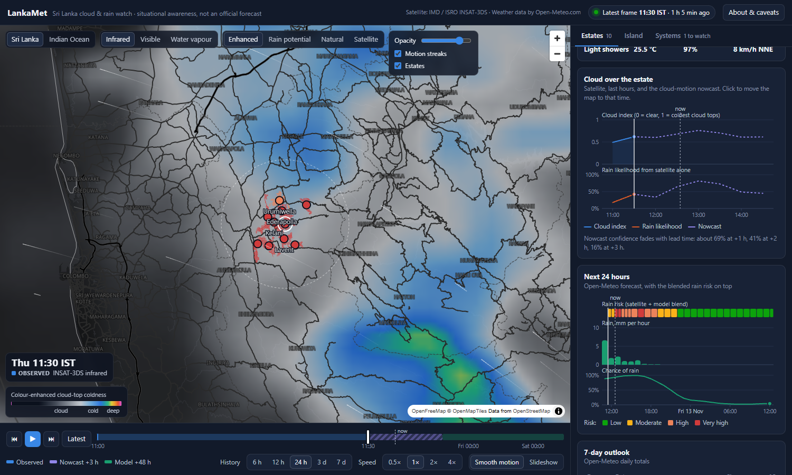

# LankaMet — Sri Lanka Cloud & Rain Watch

Near-real-time cloud analytics for Sri Lanka from the INSAT-3DS images IMD publishes every 30 minutes, a cloud-motion nowcast, and Open-Meteo forecasts for each estate.

Built from `sri-lanka-cloud-rain-dashboard-brief.md`. Situational awareness only — not an official forecast.



## Run it

```bash
npm install
npm run import-kml     # only after adding or changing KML files in data/
npm run dev            # http://localhost:3000   (or: npm run build && npm start)
```

Requires Node 20+. No API keys, no database.

The server ingests by itself while it is running: it checks IMD every 5 minutes and Open-Meteo every 3 hours. The first frame appears within a few seconds of the first start. **Animation, cloud motion and the nowcast need at least two frames, so they switch on about 30 minutes after a first start**, and the timeline fills as the server keeps running.

Everything is stored under `storage/` (git-ignored). Delete that folder to start from scratch.

## What it does

| | |
|---|---|
| **Ingest** | Downloads the IR, visible and water-vapour images when they change, reads the scan time printed in the image header, stores each scan once. |
| **Clean + georeference** | Removes IMD's coastlines, borders and grid lines, then resamples to two map-aligned fields: Sri Lanka (~3.9 km/px) and the North Indian Ocean (~7.8 km/px). |
| **Cloud metrics** | Cloud index, cloud cover, cold-top and deep-convection fractions for the island and for every estate (estate + 12 km buffer). |
| **Cloud motion** | Block-matching optical flow between consecutive frames. Drives smooth playback, the motion streaks, system movement and the nowcast. |
| **Nowcast** | The latest frame advected along the motion to +30 … +180 min, summarised per estate. |
| **Rain risk** | Satellite likelihood blended with Open-Meteo, per estate and lead time. |
| **Weather systems** | Large cold-cloud clusters scored 0–100 for organisation, with distance, movement and closing speed relative to Sri Lanka. |
| **Forecast** | Open-Meteo hourly/daily per estate, a 0.25° rain grid over the island, and ERA5 monthly normals. |

### The dashboard

- **Map** — Sri Lanka or Indian Ocean view; infrared / visible / water vapour; four colourings (enhanced, rain potential, natural, plain satellite picture); opacity; motion streaks; estates coloured by risk. Hover anywhere for the value under the pointer.
- **Timeline** — live, it shows the last 24 hours of frames (starting at the oldest one available), then continues into the nowcast (+3 h) and the model (+48 h), each in its own colour. When the store holds frames older than that — a local folder keeps 7 days — a date picker (with ‹ › and *Live*) opens an earlier Sri Lanka day as a plain 00:00–24:00 track of recorded frames. Play, step, speed. *Smooth motion* glides clouds between frames; *Slideshow* shows only the real frames. Space plays/pauses, ←/→ step.
- **Estates tab** — list sorted by 3-hour risk; click one for its risk, cloud history and nowcast, 24-hour forecast, 7-day outlook, comparison with a normal week, land use, and a CSV download.
- **Island tab** — island cloud cover and cold-top share over time, estate × time heat map, and the thresholds in use.
- **Systems tab** — the cluster list with score breakdown; click to fly there.

## How the numbers are made

All thresholds and weights live in one place: `CFG` in [lib/shared/risk.ts](lib/shared/risk.ts).

- **Cloud index** = cleaned IR grey level / 255 (0 = warm surface, 1 = coldest tops). IMD stretches the grey scale per image, so this is a relative index — not a temperature, not mm of rain.
- **Cloud** ≥ 0.45 · **cold tops** ≥ 0.82 · **deep convection** ≥ 0.96.
- **Convective intensity** = mean of a ramp from 0.55 to 0.95 over the area.
- **Satellite rain likelihood** = 1 − e^(−3.2 × convective intensity), plus a small bonus when the cloud is growing.
- **Model signal** = Open-Meteo chance of rain × (0.7 for a trace … 1.0 from 3 mm/h).
- **Risk** = w × satellite + (1 − w) × model, with w = 0.7 at +30 min, 0.5 at +1 h, 0.3 at +3 h, 0 beyond. Low < 30% ≤ Moderate < 55% ≤ High < 75% ≤ Very high. The headline is the worst value in the next 3 hours.
- **System organisation score** = size (35%) + roundness (25%) + depth (25%) + cyclonic spin (15%), scaled down within ~6° of the equator. See [lib/server/systems.ts](lib/server/systems.ts).

None of this is validated against rain gauges yet. Treat the weights as starting values.

## Things worth knowing about the data

- **`Last-Modified` cannot be used to detect or time frames.** IMD re-stamps the files every 5 minutes. A new frame is detected by a change of `Content-Length`, confirmed by SHA-256, and timed from the header text in the image (`GMT:12-11-2026/(0530-0557)`), read with a small digit matcher and accepted only when the GMT and IST stamps agree. If the header cannot be read the time is estimated and the frame is marked `timeSource: "estimated"`.
- **Frames appear 40–45 minutes after the scan starts**, so "latest" is normally 45–75 minutes old.
- **Georeferencing is fitted per frame.** The image is Mercator: `x = x0 + kx·lon`, `y = y0 − ky·ψ(lat)`. IMD was seen publishing the same scan in two horizontal extents within minutes (a variant with city labels at `kx ≈ 30.54`, then the plain one at `kx ≈ 28.56`), so the ingest finds the dotted 10° grid lines in every frame and fits the four numbers to them (`calibrate` in `lib/server/process.ts`). A frame whose grid cannot be fitted is saved to `storage/review/`, flagged `needs_review`, and not analysed. For the plain layout, Natural Earth's coastline lands on IMD's within a pixel: [docs/calibration_check.png](docs/calibration_check.png).
- **The city-label variant** also carries orange place names and white city markers. Both are masked and filled in, but "Colombo" is printed just south-west of the estates, so cloud values there are less exact in those frames. In the one case observed, IMD replaced the labelled picture with the plain one a few minutes later, and the app then replaced its copy too. The label and marker removal ran on that one frame without error but its output was not inspected before the frame was replaced.
- **Estates:** the "Kalupahana" KML actually contains all estates, including Panawaththa, which has no file of its own. The importer groups parcels by their `ESTATE` attribute and drops duplicates, giving 10 estates.

## Where things are

```
app/                 page + API routes (state, field, forecast, ingest, estate CSV)
components/          Dashboard, MapView, Timeline, Panels, charts, CaveatsModal
lib/shared/          geo (calibration), flow (optical flow + advection), risk, palettes, types
lib/server/          ingest, process (cleaning), header-time, systems, openmeteo, state, store
lib/client/          field engine (loading, interpolation), timeline model, formatting
scripts/             import-kml.mjs, calibrate.py, make-digit-templates.py
data/                estate KML files and the generated estates.json
storage/             raw frames (14 days), fields, index.json, forecast cache  (git-ignored)
```

API: `GET /api/state` (live: the last 24 hours) or `?day=YYYY-MM-DD` (an earlier Sri Lanka date) · `GET /api/forecast` · `GET /api/field/{ir1|vis|wv}/{sl|region}/{id}` · `GET /api/estates/{slug}/csv` · `GET /api/ingest` (health) · `POST /api/ingest` (`?reprocess=1` rebuilds everything from the raw frames, `?forecast=1` forces an Open-Meteo refresh).

Environment (all optional): `LANKAMET_KEEP_HOURS` (retention, see Deploying on Vercel), `LANKAMET_BACKEND=blob` (make a local run use the Blob store), `NEXT_DIST_DIR` (separate build folder, so a build or second server can run beside `npm run dev`), `OPEN_METEO_API_KEY` (a paid Open-Meteo key; switches to the `customer-api` endpoints — `OPEN_MET_KEY` is accepted too), `LANKAMET_STORAGE`, `LANKAMET_USER_AGENT` (put a contact email here before deploying), `IMD_BASE_URL`, `OPEN_METEO_BASE`, `NEXT_PUBLIC_MAP_STYLE_URL`, `LANKAMET_NO_SCHEDULER=1`. Put them in `.env` (git-ignored) or the host's environment settings.

## Deploying on Vercel

Serverless functions have no disk and do not run between requests, so on Vercel the app stores everything in **Vercel Blob** and is driven by an external cron. Local development is unchanged (files under `storage/`); the Blob backend switches on automatically on Vercel when `BLOB_STORE_ID` (OIDC, set by current Blob connections) or `BLOB_READ_WRITE_TOKEN` is present. On a developer machine a store id alone is ignored, because there is no OIDC token to go with it. Stores are treated as private; set `LANKAMET_BLOB_ACCESS=public` for an older public store.

1. **Import the repo** into a Vercel project (framework: Next.js, defaults are fine). `vercel.json` pins functions to Mumbai (`bom1`) so IMD downloads do not time out from the US.
2. **Storage → Create → Blob**, and connect the store to the project. That sets `BLOB_STORE_ID` (the SDK authenticates with the deployment's OIDC token).
3. **Environment variables:** `CRON_SECRET` (any long random string; protects the ingest endpoint) and `OPEN_METEO_API_KEY`. Redeploy after adding them.
4. **Polling.** Vercel Cron only runs once a day on the Hobby plan, so the repo ships a GitHub Actions workflow (`.github/workflows/ingest.yml`) that calls `GET /api/ingest?run=1` every 10 minutes. In the GitHub repo add two **Actions secrets**: `LANKAMET_URL` (e.g. `https://lanka-met.vercel.app`) and `CRON_SECRET` (same value as on Vercel). On a Pro plan you can instead change the schedule in `vercel.json` to `*/5 * * * *`.
5. Open `https://<app>/api/ingest` to see ingest health, or `…/api/ingest?run=1&key=<CRON_SECRET>` to run a pass by hand.

One pass (three HEADs, up to three downloads, analysis, nowcast) takes 10–25 s and must finish inside the function's 60 s limit. GitHub's schedule can drift by several minutes, so expect frames to appear 45–60 min after their scan time.

**Retention.** On Blob the app keeps 24 hours of frames: whenever a new frame is stored, raw frames, fields and index entries older than that are deleted, so the store stays at roughly 110 MB (48 frames × 3 channels). Change it with `LANKAMET_KEEP_HOURS`. A local folder keeps 7 days of index, 14 days of raw frames and all fields unless that variable is set.

**Uploading frames recorded locally.** `npm run sync-blob` copies the last 24 hours of this machine's `storage/` (raw frames and fields) to the Blob store and merges the frame index with production's, so nothing production recorded is lost. It needs write access, one of: (a) connect the store to the project's **Development** environment as well (Vercel → Storage → the store → Projects), then `npx vercel link` — the token it writes to `.env.local` lasts about 12 hours and is only accepted for environments the store is connected to; or (b) put a `BLOB_READ_WRITE_TOKEN` in `.env.local`. A `BLOB_STORE_ID` alone only names the store. `--force` also overwrites the small state files.

Known limits of the serverless setup: two overlapping passes (e.g. a manual run during the cron tick) can both write `index.json`; the later write wins and may drop the other's frame. A dropped frame is picked up again by `?reprocess=1`, which rebuilds everything from the stored raw frames.

**Other hosts:** any long-running Node host (VPS, Docker, Railway, Render, Fly.io) works with no configuration — mount a persistent volume at `storage/` or point `LANKAMET_STORAGE` at one, and the in-process scheduler does the polling.

## Differences from the brief

| Brief | Here | Why |
|---|---|---|
| Supabase + Python worker + GitHub Actions cron | One Next.js process with a file store and an in-process scheduler | Runs with `npm run dev` and no accounts. The store is isolated in `lib/server/store.ts` and the schema mirrors the brief's tables, so moving to Postgres later is contained. |
| OpenCV Farnebäck / pysteps | Block-matching flow in TypeScript | The same code runs in the server (nowcast) and the browser (playback). |
| Scan time from `Last-Modified` | Read from the image header | `Last-Modified` changes every 5 minutes regardless of content. |
| CTBT channel | Not ingested | It is a contour-line product from a different satellite and layout, a few hours behind. |
| Admin pages, auth, KML upload | Not built | No auth backend in this setup. Add KML files to `data/` and run `npm run import-kml`. |
| Phase 3 (IMERG validation, learned model, alerts), MOSDAC | Not built | Needs months of stored frames and external accounts. |
| 0.1° grid metrics table | Not stored | The browser has the full-resolution field; per-estate and island metrics are stored per frame. |

## Before going public or commercial

- Confirm IMD's reuse terms for the imagery.
- Open-Meteo's free tier is non-commercial only (the app uses roughly 2,500 call-equivalents a day, under the 10,000 limit).
- Set `LANKAMET_USER_AGENT` to something with a contact address.

Attribution: satellite imagery IMD / ISRO INSAT-3DS · weather data by [Open-Meteo.com](https://open-meteo.com/) (CC BY 4.0) · basemap OpenFreeMap / OpenMapTiles / OpenStreetMap · Sri Lanka outline Natural Earth.
